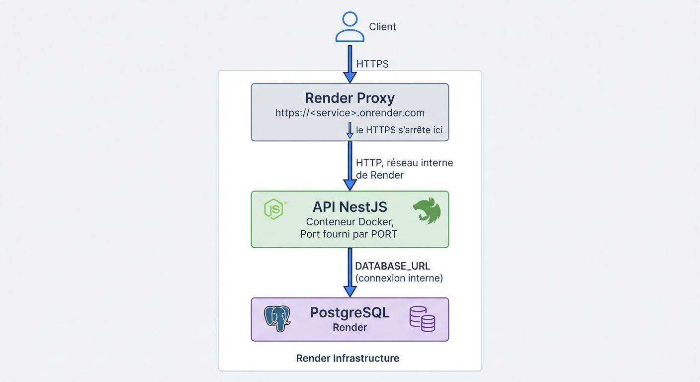

# Rendu — Lundi

Tests de l'API en local sur `http://localhost:3000`.

## Sommaire

1. [Vérifier que l'API répond](#1-vérifier-que-lapi-répond)
2. [Créer une salle](#2-créer-une-salle)
3. [Réserver un créneau](#3-réserver-un-créneau)
4. [Réserver le même créneau (conflit)](#4-réserver-le-même-créneau-conflit)
5. [Réserver un créneau qui chevauche (conflit)](#5-réserver-un-créneau-qui-chevauche-conflit)

---

## 1. Vérifier que l'API répond

**Requête**

```bash
curl -i http://localhost:3000/health
```

**Réponse** — `200 OK`

```http
HTTP/1.1 200 OK
X-Powered-By: Express
Content-Type: application/json; charset=utf-8
Content-Length: 15
ETag: W/"f-VaSQ4oDUiZblZNAEkkN+sX+q3Sg"
Date: Mon, 23 Nov 2026 13:05:01 GMT
Connection: keep-alive
Keep-Alive: timeout=5
```

```json
{"status":"ok"}
```

---

## 2. Créer une salle

**Requête**

```bash
curl -i http://localhost:3000/salles \
  -H 'Content-Type: application/json' \
  -d '{"nom":"Salle 204"}'
```

**Réponse** — `201 Created`

```http
HTTP/1.1 201 Created
X-Powered-By: Express
Content-Type: application/json; charset=utf-8
Content-Length: 26
ETag: W/"1a-l2x+sbD9yV0Yq+bYuhb47vZ1X2U"
Date: Mon, 23 Nov 2026 13:11:28 GMT
Connection: keep-alive
Keep-Alive: timeout=5
```

```json
{"id":1,"nom":"Salle 204"}
```

---

## 3. Réserver un créneau

Réservation de la salle 1 de 09:00 à 10:00.

**Requête**

```bash
curl -i http://localhost:3000/reservations \
  -H 'Content-Type: application/json' \
  -d '{"salleId":1,"debut":"2030-10-15T09:00:00Z","fin":"2030-10-15T10:00:00Z"}'
```

**Réponse** — `201 Created`

```http
HTTP/1.1 201 Created
X-Powered-By: Express
Content-Type: application/json; charset=utf-8
Content-Length: 89
ETag: W/"59-jY01dh8Uh9XLgxNXIfHgC4PTaBk"
Date: Mon, 23 Nov 2026 12:59:14 GMT
Connection: keep-alive
Keep-Alive: timeout=5
```

```json
{"id":1,"salle_id":1,"debut":"2030-10-15T09:00:00.000Z","fin":"2030-10-15T10:00:00.000Z"}
```

---

## 4. Réserver le même créneau (conflit)

Même requête qu'à l'étape 3 : la salle est déjà prise de 09:00 à 10:00.

**Requête**

```bash
curl -i http://localhost:3000/reservations \
  -H 'Content-Type: application/json' \
  -d '{"salleId":1,"debut":"2030-10-15T09:00:00Z","fin":"2030-10-15T10:00:00Z"}'
```

**Réponse** — `409 Conflict`

```http
HTTP/1.1 409 Conflict
X-Powered-By: Express
Content-Type: application/json; charset=utf-8
Content-Length: 99
ETag: W/"63-z1mfA4gGgyh3snwCTmwWTnYwmBU"
Date: Mon, 23 Nov 2026 13:20:13 GMT
Connection: keep-alive
Keep-Alive: timeout=5
```

```json
{"message":"Cette salle est déjà réservée sur ce créneau","error":"Conflict","statusCode":409}
```

---

## 5. Réserver un créneau qui chevauche (conflit)

Créneau de 09:30 à 10:30, qui empiète sur la réservation 09:00–10:00.

**Requête**

```bash
curl -i http://localhost:3000/reservations \
  -H 'Content-Type: application/json' \
  -d '{"salleId":1,"debut":"2030-10-15T09:30:00Z","fin":"2030-10-15T10:30:00Z"}'
```

**Réponse** — `409 Conflict`

```http
HTTP/1.1 409 Conflict
X-Powered-By: Express
Content-Type: application/json; charset=utf-8
Content-Length: 99
ETag: W/"63-z1mfA4gGgyh3snwCTmwWTnYwmBU"
Date: Mon, 23 Nov 2026 13:32:06 GMT
Connection: keep-alive
Keep-Alive: timeout=5
```

```json
{"message":"Cette salle est déjà réservée sur ce créneau","error":"Conflict","statusCode":409}
```

---

### Traitement

Fichier `src/app.ts`, méthode `reserver()`, route `POST /reservations` :

1. Valide `salleId` et le créneau (dates UTC ISO, fin après début — règle dans `regles.ts`).
2. Ouvre une transaction et verrouille la salle (`SELECT ... FOR UPDATE`), erreur **404** si elle n'existe pas.
3. Refuse tout chevauchement avec `seChevauchent()`, erreur **409**.
4. Insère la réservation puis `COMMIT` (`ROLLBACK` en cas d'erreur).

### Enregistrement

Fichier `projet-depart/src/database.ts` : un `Pool` PostgreSQL (`pg`), configuré par `DATABASE_URL`, crée au démarrage les tables :

- `salles`
- `reservations` (clé étrangère vers `salles`, contrainte `fin > debut`)

Toutes les requêtes SQL passent par `this.db.pool`.

### Base de données

Fournie par `compose.yaml` en local et par `render.yaml` au déploiement.

### Limite à noter

> La base n'interdit pas elle-même les chevauchements (pas de contrainte d'exclusion). Seul le code les bloque, grâce au verrou `FOR UPDATE`.

### Schéma


