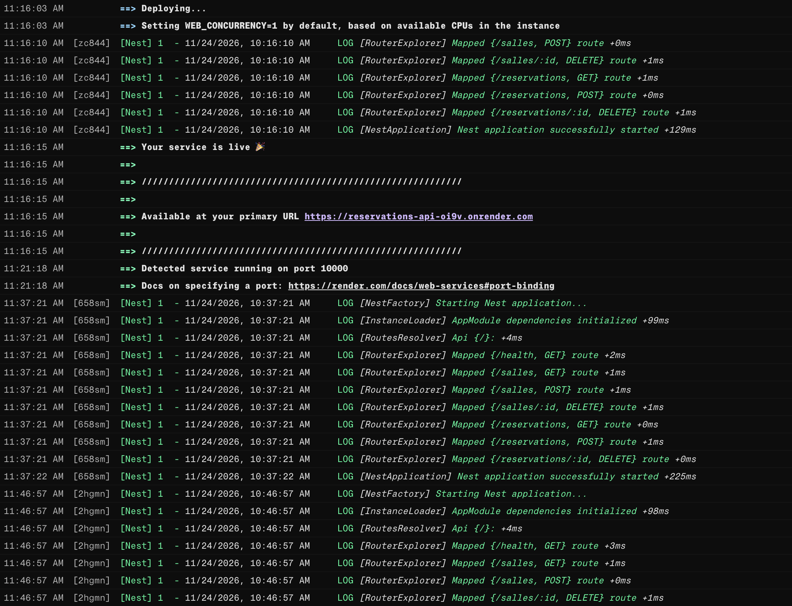
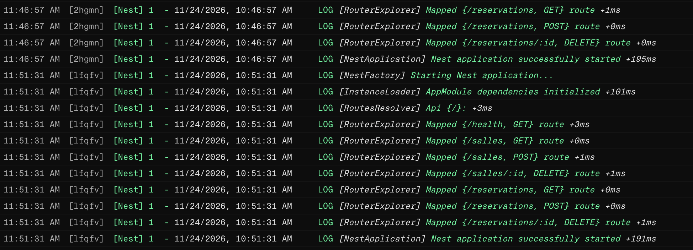

# Rendu — Mardi

Tests de l'API déployée sur Render.

| | |
|---|---|
| **URL HTTPS** | <https://reservations-api-oi9v.onrender.com/> |
| **SHA** | `1c-+LIg7bbDOJYWh+uRQZFQXMqet7E` |

## Sommaire

1. [Réserver un créneau (premier essai)](#1-réserver-un-créneau-premier-essai)
2. [Réserver le même créneau (deuxième essai)](#2-réserver-le-même-créneau-deuxième-essai)
3. [Vérifier que l'API répond](#3-vérifier-que-lapi-répond)
4. [Lister les salles après redémarrage](#4-lister-les-salles-après-redémarrage)
5. [Logs Render](#5-logs-render)

---

## 1. Réserver un créneau (premier essai)

Réservation de la salle 1 de 09:00 à 10:00.

**Requête**

```bash
curl -i "https://reservations-api-oi9v.onrender.com/reservations" \
  -H 'Content-Type: application/json' \
  -d '{"salleId":1,"debut":"2030-10-15T09:00:00Z","fin":"2030-10-15T10:00:00Z"}'
```

**Réponse** — `201 Created`

```http
HTTP/2 201
date: Tue, 24 Nov 2026 10:39:04 GMT
content-type: application/json; charset=utf-8
etag: W/"59-jY01dh8Uh9XLgxNXIfHgC4PTaBk"
rndr-id: 9eac040a-5355-4325
server: cloudflare
vary: Accept-Encoding
x-powered-by: Express
x-render-origin-server: Render
cf-cache-status: DYNAMIC
cf-ray: a5f7c9a4dfda83e2-CDG
alt-svc: h3=":443"; ma=86400
```

```json
{"id":1,"salle_id":1,"debut":"2030-10-15T09:00:00.000Z","fin":"2030-10-15T10:00:00.000Z"}
```

---

## 2. Réserver le même créneau (deuxième essai)

Même requête : la salle est déjà prise de 09:00 à 10:00.

**Requête**

```bash
curl -i "https://reservations-api-oi9v.onrender.com/reservations" \
  -H 'Content-Type: application/json' \
  -d '{"salleId":1,"debut":"2030-10-15T09:00:00Z","fin":"2030-10-15T10:00:00Z"}'
```

**Réponse** — `409 Conflict`

```http
HTTP/2 409
date: Tue, 24 Nov 2026 10:39:35 GMT
content-type: application/json; charset=utf-8
etag: W/"63-z1mfA4gGgyh3snwCTmwWTnYwmBU"
rndr-id: 27c9215b-28d5-4f81
server: cloudflare
vary: Accept-Encoding
x-powered-by: Express
x-render-origin-server: Render
cf-cache-status: DYNAMIC
cf-ray: a5f7ca690e693740-CDG
alt-svc: h3=":443"; ma=86400
```

```json
{"message":"Cette salle est déjà réservée sur ce créneau","error":"Conflict","statusCode":409}
```

---

## 3. Vérifier que l'API répond

**Requête**

```bash
curl -i "https://reservations-api-oi9v.onrender.com/health"
```

**Réponse** — `200 OK`

```http
HTTP/2 200
date: Tue, 24 Nov 2026 10:44:33 GMT
content-type: application/json; charset=utf-8
etag: W/"f-VaSQ4oDUiZblZNAEkkN+sX+q3Sg"
rndr-id: 363b249a-410c-4c08
server: cloudflare
vary: Accept-Encoding
x-powered-by: Express
x-render-origin-server: Render
cf-cache-status: DYNAMIC
cf-ray: a5f7d1aaa85eb6b4-CDG
alt-svc: h3=":443"; ma=86400
```

```json
{"status":"ok"}
```

---

## 4. Lister les salles après redémarrage

Après redémarrage du service, la salle créée est toujours là : les données sont bien persistées en base.

**Requête**

```bash
curl -i "https://reservations-api-oi9v.onrender.com/salles"
```

**Réponse** — `200 OK`

```http
HTTP/2 200
date: Tue, 24 Nov 2026 10:47:41 GMT
content-type: application/json; charset=utf-8
etag: W/"1c-+LIg7bbDOJYWh+uRQZFQXMqet7E"
rndr-id: bfa72e17-b152-463b
server: cloudflare
vary: Accept-Encoding
x-powered-by: Express
x-render-origin-server: Render
cf-cache-status: DYNAMIC
cf-ray: a5f7d641bb39acc1-CDG
alt-svc: h3=":443"; ma=86400
```

```json
[{"id":1,"nom":"Salle 204"}]
```

---

## 5. Logs Render

**Début**



**Fin**


